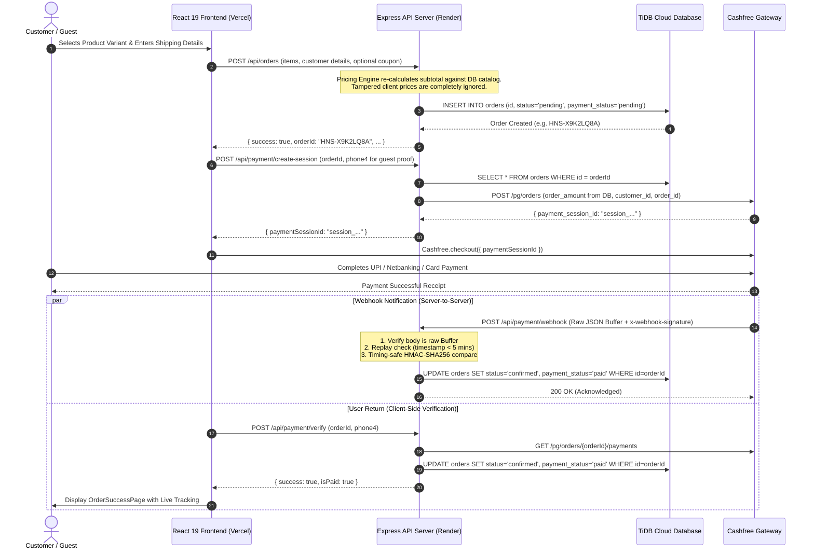
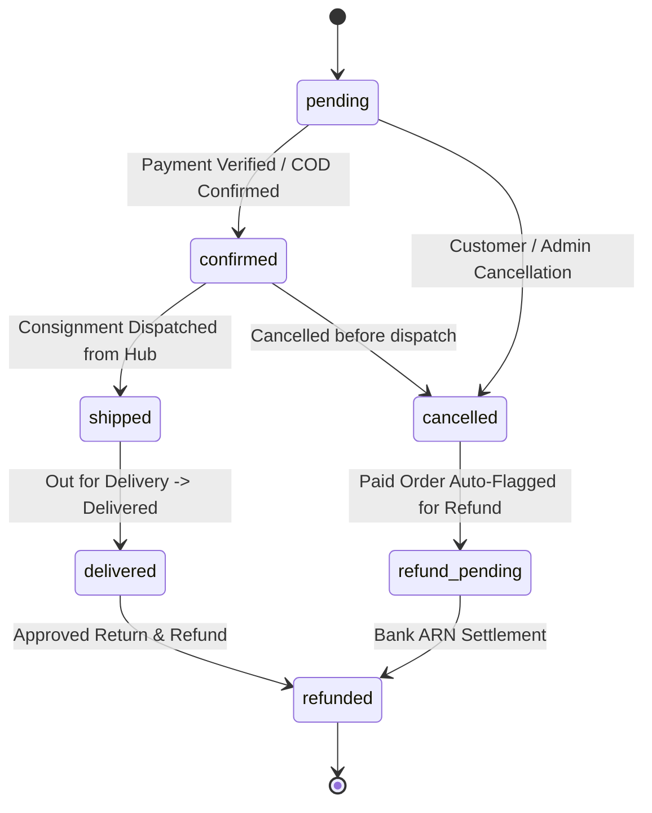

# Architecture & Data Flow Guide: Haji Nuts & Spices

This document outlines the end-to-end architectural flow of the **Haji Nuts & Spices** e-commerce platform across order creation, payment gateway handshakes, webhook event handling, and delivery lifecycle tracking.

---

## 1. System Topology Overview

```mermaid
graph TD
    Client[React 19 Frontend<br/>Vercel] -->|Vercel Rewrites /api/*| Backend[Express Backend<br/>Render.com]
    Backend -->|Parameterized Queries (SSL)| DB[(TiDB Cloud / MySQL)]
    Client -->|Checkout SDK Session| Cashfree[Cashfree Payment Gateway]
    Cashfree -->|HMAC-SHA256 Webhook| Backend
    Backend -->|Images / Cloud Storage| Cloudinary[(Cloudinary CDN)]
```

---

## 2. Order → Payment → Webhook Flow



---

## 3. Order Status State Machine

The order lifecycle adheres strictly to the state transition graph defined in `server/services/orderService.js`:



---

## 4. Guest Tracking Security

To protect customers from order enumeration or data scraping:
- **Order IDs**: Generated as random alphanumeric tokens (`HNS-<8 characters>`) with collision retry loops rather than sequential IDs (`HNS-001`, `HNS-002`).
- **Owner vs Guest Isolation**:
  - Registered account owners and admins receive complete order details via JWT bearer tokens.
  - Unauthenticated guests querying `GET /api/orders/:id` **must** provide `?phone4=XXXX` matching the last 4 digits of the phone number associated with the order.
  - Unverified guest requests return 401/403 or sanitized minimal tracking payloads, preventing leak of recipient street addresses or line items.
